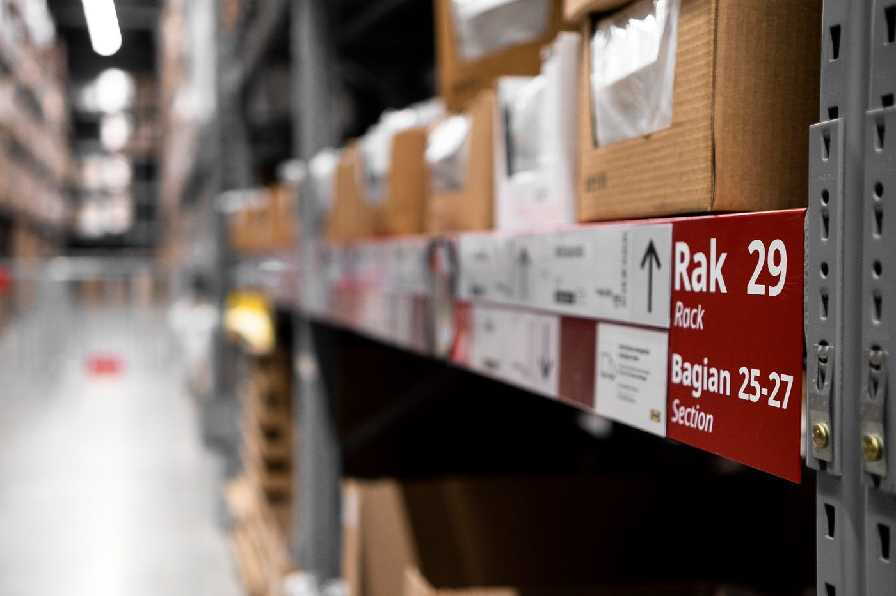

AWS S3 storage has been one of the most popular and widely used cloud storage services in recent years. With its flexibility, scalability, and cost-effectiveness, S3 provides businesses with a reliable and secure way to store, retrieve, and manage their data. However, not all data is the same, and not all storage requirements are identical. To meet the diverse needs of customers, AWS offers a range of S3 storage classes, each optimized for a particular use case. In this article, we will explore the different S3 storage classes, their features, and best practices for their use, to help you choose the right storage class for your organization’s needs.

*Photo by [Arum Visuals](https://unsplash.com/@arumvisuals?utm_source=medium&utm_medium=referral) on [Unsplash](https://unsplash.com?utm_source=medium&utm_medium=referral)*

When it comes to storing data in the cloud, Amazon Web Services (AWS) Simple Storage Service (S3) is one of the most popular choices. S3 is a highly scalable, durable, and secure object storage service that can be used to store and retrieve any amount of data, at any time, from anywhere on the web. However, not all data is created equal, and not all data needs to be accessed frequently. To cater to different data storage needs, AWS offers six different S3 storage classes, each with its own unique characteristics and pricing model.

## What is AWS S3?

Amazon S3 is an object storage service that offers industry-leading scalability, data availability, security, and performance. S3 allows you to store and retrieve any amount of data from anywhere on the web. It is designed to provide 99.999999999% (11 nines) durability for data, meaning that your data is highly resilient to hardware failures, errors, and data center disruptions. S3 is a suitable storage solution for a wide range of use cases, including backup and recovery, media storage, content delivery, big data analytics, and archiving.

## What are S3 Storage Classes?

S3 storage classes are used to categorize data based on the frequency of access, durability, and cost. AWS offers six different storage classes, each with its own unique characteristics. The six S3 storage classes are:

- S3 Standard
- S3 Standard-Infrequent Access
- S3 One Zone-Infrequent Access
- S3 Intelligent-Tiering
- S3 Glacier
- S3 Glacier Deep Archive

Let’s take a closer look at each storage class and their unique features.

## Understanding the Different Storage Classes

- **S3 Standard:**S3 Standard is the default storage class for Amazon S3 and is designed for frequently accessed data. It offers high durability, availability, and performance for storing mission-critical data. With S3 Standard, you can store any amount of data and retrieve it at any time with low-latency performance. S3 Standard is ideal for use cases that require real-time access to data, such as websites, mobile applications, and content distribution.
- **S3 Standard-Infrequent Access:**S3 Standard-Infrequent Access is a low-cost storage class that is designed for data that is accessed less frequently but requires rapid access when needed. It offers the same durability and availability as S3 Standard but at a lower cost. With S3 Standard-Infrequent Access, you pay a retrieval fee when you access your data.S3 Standard-Infrequent Access is ideal for use cases that require infrequent access to data, such as backups, disaster recovery, and long-term storage.
- **S3 One Zone-Infrequent Access:**S3 One Zone-Infrequent Access is similar to S3 Standard-Infrequent Access but stores data in a single availability zone. This means that if that availability zone experiences an outage, your data may be lost. This storage class offers the same durability and low retrieval fees as S3 Standard-Infrequent Access, but at a lower cost due to the increased risk of data loss. S3 One Zone-Infrequent Access is ideal for use cases where data can be easily recreated, such as secondary backups or data that is already stored in other locations.
- **S3 Intelligent-Tiering:**S3 Intelligent-Tiering is a storage class that automatically moves data between two access tiers based on changing access patterns. This storage class offers frequent and infrequent access tiers, with the option to move data to S3 Glacier or S3 Glacier Deep Archive for long-term archival. S3 Intelligent-Tiering is ideal for use cases where data access patterns are unpredictable or frequently changing, such as data analytics, multimedia, and general-purpose storage. It uses machine learning to analyze data access patterns and move objects to the most cost-effective access tier without any performance impact
- **S3 Glacier:**S3 Glacier is a low-cost storage class that is designed for long-term data archiving. It offers very low storage costs but with a retrieval time of several hours. S3 Glacier is ideal for data that is rarely accessed but needs to be stored for compliance or regulatory purposes.
- **S3 Glacier Deep Archive:**S3 Glacier Deep Archive is the most cost-effective storage class for long-term data archiving. It offers the lowest storage costs but with a retrieval time of up to 12 hours. S3 Glacier Deep Archive is ideal for data that is required to be stored for long periods and accessed very rarely.

## Factors to Consider When Choosing a Storage Class

When choosing an S3 storage class, it is important to consider the following factors:

- **Data Access Frequency**: Consider how frequently your data needs to be accessed. If it is frequently accessed, S3 Standard or S3 Standard-Infrequent Access may be the best option.
- **Data Retrieval Time**: Consider how quickly you need to retrieve your data. S3 Standard offers the lowest retrieval time, while S3 Glacier Deep Archive offers the highest retrieval time.
- **Data Durability and Availability**: Consider the durability and availability of your data. S3 Standard offers the highest durability and availability, while S3 One Zone-Infrequent Access offers lower durability due to its single availability zone.
- **Data Lifecycle and Retention Period**: Consider the lifecycle of your data and how long you need to retain it. S3 Intelligent-Tiering is ideal for data with unpredictable access patterns, while S3 Glacier and S3 Glacier Deep Archive are ideal for long-term archiving.

## Use Cases for Each Storage Class

Here are some common use cases for each S3 storage class:

**S3 Standard**

- Websites and mobile applications
- Content distribution
- General-purpose storage

**S3 Standard-Infrequent Access**

- Backup and recovery
- Disaster recovery
- Long-term storage

**S3 One Zone-Infrequent Access**

- Secondary backups
- Storages that can easily be recreated
- Non-critical data

**S3 Intelligent-Tiering**

- Data analytics
- Multimedia
- General-purpose storage

**S3 Glacier**

- Long-term archival
- Compliance and regulatory requirements

**S3 Glacier Deep Archive**

- Long-term archival
- Compliance and regulatory requirements for data retention

## Best Practices for Managing S3 Storage Classes

Amazon Web Services (AWS) offers a number of different storage classes for its Simple Storage Service (S3), each with varying levels of performance, durability, and cost. When managing your S3 storage, it’s important to choose the right storage class for your needs to optimize performance, cost, and data durability. Here are some best practices for managing your S3 storage classes:

- **Defining Object Lifecycle Policy**

One of the best practices for managing your S3 storage classes is to define an object lifecycle policy. An object lifecycle policy helps you automate the transition of objects from one storage class to another or deletion, based on the object age or size or other conditions that you define. This can help you save costs by automatically moving less frequently accessed data to a lower-cost storage class, and deleting it when it’s no longer needed.

- **Setting Up Cross-Region Replication**

Another best practice for managing your S3 storage classes is to set up cross-region replication. Cross-region replication automatically replicates data from one bucket to another in a different region for data redundancy and disaster recovery purposes. With cross-region replication, you can choose different storage classes for the replicated data to optimize performance, cost, and durability.

- **Using S3 Inventory for Reporting and Analysis**

S3 Inventory is another tool that can help you manage your S3 storage classes. S3 Inventory is a feature that provides a scheduled report of your objects and their metadata for auditing and analysis purposes. It can help you understand your object access patterns and lifecycle patterns, which can help you optimize your storage costs. You can also use S3 Inventory to automate data governance and compliance audits.

- **Implementing Security and Access Control**

Security and access control are crucial aspects of managing your S3 storage classes. With S3, you can create IAM policies and bucket policies to control who can access your S3 buckets and objects. You can also use features such as Amazon S3 Block Public Access to prevent public access to your S3 buckets and objects. Proper security and access control can help you protect your data and prevent unauthorized access.

- **Monitoring and Cost Optimization for S3 Storage Classes**

Once you have set up your S3 storage classes, it’s important to monitor and optimize your storage costs. Here are some best practices:

- **Using CloudWatch Metrics and Alarms**

CloudWatch Metrics and Alarms can help you monitor your S3 storage usage and costs. You can use CloudWatch to monitor metrics such as bucket size, number of requests, data transfer, and more. You can also set up CloudWatch Alarms to alert you when a metric threshold is breached. This can help you proactively optimize your storage costs.

- **Using S3 Storage Class Analysis**

S3 Storage Class Analysis is a feature that provides S3 customers with a detailed inventory of objects and their access patterns. It can help you identify objects that are rarely accessed, so you can move them to a lower-cost storage class or archive them to Glacier. It can also help you identify objects that are frequently accessed, so you can optimize their retrieval costs.

- **Cost Optimization Strategies**

There are several strategies to optimize your S3 storage costs. For example, you can use lifecycle policies to move infrequently accessed data to a lower-cost storage class or archive it to Glacier. You can also use S3 Intelligent-Tiering to automatically move objects between four different access tiers based on changing access patterns. Additionally, you can use Amazon S3 Requester Pays to share the cost of accessing your S3 objects with external customers or partners.In conclusion, AWS S3 storage classes offer a wide range of options to choose from depending on the specific requirements of your data. With careful consideration of the frequency of data access, retrieval time, durability, and lifecycle, you can select the optimal storage class for your use case. By following best practices for managing and monitoring your S3 storage, you can ensure high availability, security, and cost optimization. Whether you need to store frequently accessed data or archive it for long-term retention, AWS S3 has a storage class that fits your needs.

There are several strategies to optimize your S3 storage costs. For example, you can use lifecycle policies to move infrequently accessed data to a lower-cost storage class or archive it to Glacier. You can also use S3 Intelligent-Tiering to automatically move objects between four different access tiers based on changing access patterns. Additionally, you can use Amazon S3 Requester Pays to share the cost of accessing your S3 objects with external customers or partners.In conclusion, AWS S3 storage classes offer a wide range of options to choose from depending on the specific requirements of your data. With careful consideration of the frequency of data access, retrieval time, durability, and lifecycle, you can select the optimal storage class for your use case. By following best practices for managing and monitoring your S3 storage, you can ensure high availability, security, and cost optimization. Whether you need to store frequently accessed data or archive it for long-term retention, AWS S3 has a storage class that fits your needs.
