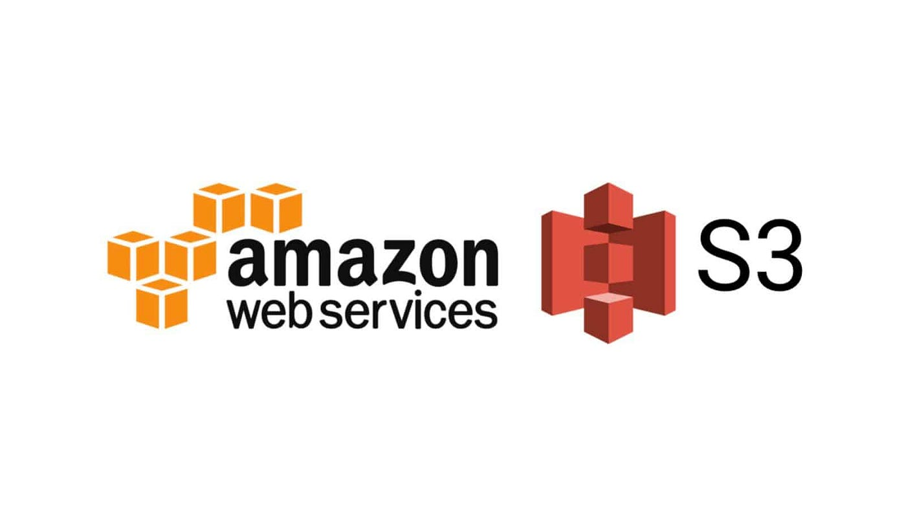
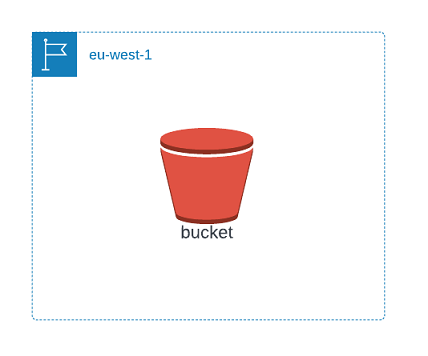
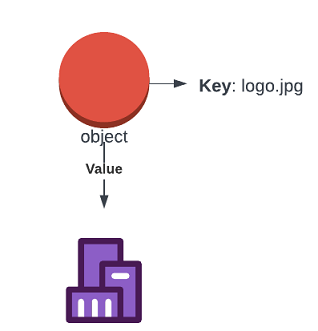

S3 is a global storage platform that is accessible from anywhere with an Internet connection. It is a public service that runs from all AWS regions, making it a globally available resource

However, S3 is regionally based, meaning that your data is stored in a specific AWS region and never leaves that region unless you explicitly configure it to do so.

This regional resilience ensures that your data is replicated across availability zones in that region, making it tolerant to the failure of an AZ. Additionally, S3 has the ability to replicate data between regions, providing an extra layer of protection for your data.

While S3 may seem confusing at first, it is easy to use once you understand its regional-based structure. When using S3 from the AWS console, you do not have to select a region. Instead, you select a region when you create resources inside S3. This makes it easy to manage your data and ensure that it is stored in the correct region.

S3 is designed to handle unlimited amounts of data and is perfect for hosting large amounts of data such as movies, audio distribution, large-scale photo storage, textual data, big data sets, and more. It is also ideal for multi-user usage, allowing millions of users to access files stored in S3.

S3 also scales from nothing to near-unlimited levels, making it a versatile and valuable resource for businesses of all sizes.

One of the best things about S3 is its affordability. It is a great value service for storing and allowing access to data, and it can be accessed using a variety of methods, including the GUI, command line interface, AWS APIs, or even standard methods such as HTTP. S3 is the default storage service in AWS, making it an essential tool for businesses that rely on AWS.

S3 delivers two main things:

- Objects are the data that S3 stores, such as pictures, files, videos, and more.
- Buckets are the containers for objects, making it easy to organize

## Buckets

S3 buckets are a crucial component of AWS, and they are created in a specific region. The data stored within a bucket has a primary home region, and it remains there unless you or one of your system administrators configures it to leave. This ensures that S3 maintains stable and controlled data sovereignty. By creating a bucket in a specific region, you can control the laws and regulations that apply to your data. Additionally, the blast radius of a failure is limited to that region, meaning that any major failure, such as a natural disaster or data corruption, will be contained within that region.

Each bucket is identified by its name, which must be globally unique across all AWS accounts and regions. This means that if you choose a bucket name, no one else can use it in any AWS account. A bucket can hold an unlimited number of objects, and since objects can range from zero to five TB in size, a bucket can hold an infinite amount of data, making it an infinitely scalable storage system.

As an object storage system, S3 buckets have a flat structure, meaning that all objects stored within the bucket are at the same level. Unlike a file system, where you can have files within folders, everything is stored in the bucket at the root level. However, when you list an S3 bucket, you will see what appears to be folders, and the UI presents them as such.

In your AWS account, you can have up to 100 buckets, which is a soft limit. However, this limit can be increased using support tickets to AWS. It’s important to note that the number of buckets cannot exceed 1000, which is a hard limit.

## Objects

When working with S3, it can be helpful to think of an object as a file. While there are some conceptual differences, for the most part, they are interchangeable. An S3 object is composed of two main components and some associated meta-data.

- First, there is the key. You can think of this as similar to a file name. The key identifies the object in a bucket. So, if you know the object key and the bucket, you can uniquely access the object (assuming you have the necessary permissions). By default, even for public services, there is no access in AWS initially except for the account root user.
- Second, there is the value. This is the data or contents of the object. In this case, it is a sequence of binary data that represents a logo. The value of an object can range from zero bytes up to five terabytes in size. This means that you can have an empty object or one that is a massive 5 TB. This scalability is one of the reasons why S3 is so useful in a wide range of situations.

In addition to the key and value, there are other components of an object, including the version ID, meta-data, access control, and more. By understanding these components, you can better utilize S3 to meet your needs.

In upcoming articles, we will delve deeper into the various components that make up an object. Our exploration will provide a comprehensive understanding of each element and its role in the overall S3 structure.
