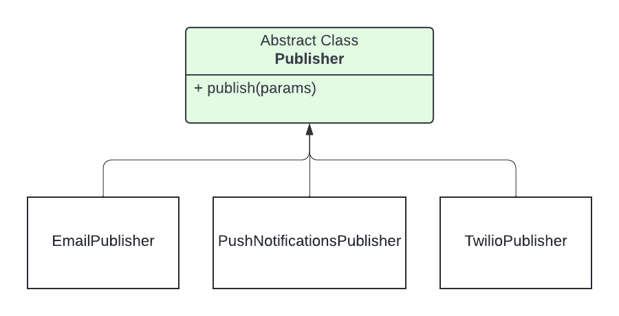
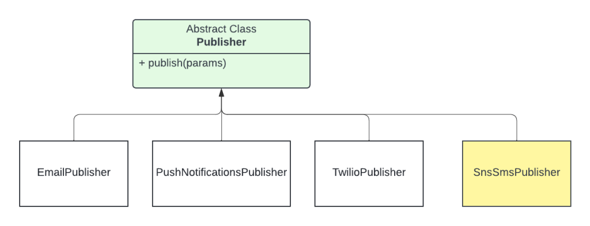

Spring boot is a widely used framework to bootstrap standalone web applications. Its flexibility and capabilities in beans management make the life of the developer much easier compared to the manual handling of these components.


In this blog post, I will describe a use case where I needed the help of Spring Boot to create beans based on a configuration set in my `application.yml` file.

## Problem Description

I was working on a notification service where depending on events received and the configuration set up, notifications of different types were sent to users. These notifications were emails, SMS messages and push notifications for mobile applications.

The usage of SMS messages increased and this impacted the bill that the company had to pay to the third party which is [Twilio](https://www.twilio.com/en-us).

Because of that, we decided to look for another third-party tool that can send SMS messages but at cheaper prices, and the decision was made to use the AWS SNS service since the notification service is already running on AWS.

At this point we should have no problem doing this replacement, it’s just a matter of coding a new SMS provider for our service and replacing the old one.

### Multi-region Service Deployment

An important piece of information that I didn’t mention earlier is that the notification service is deployed on different regions in AWS, three exactly: Ireland (eu-west-1), Canada (central), and the Asia Pacific — Singapore (ap-southeast-1)

This multi-region deployment was the root cause of the issue we had: The sending of SMS messages through SNS was not already available in the Canada region but was possible in the two other regions.

At that time we had to decide what to do:

1. Wait until the SMS feature is deployed by AWS in the Canada region and keep using Twilio in all regions
2. Implement the use of AWS SNS to send SMS messages in Ireland and Singapore regions, and keep using Twilio in Canada region

Finally, we decided to go for the second solution for the following reasons:

1. It was technically possible to use Spring Boot which is an obvious reason otherwise all of this would not make sense
2. The most important part of the SMS costs came from the Ireland and Singapore regions. Customers in the Canada region were not using this feature too much.

So it makes sense to start using AWS SNS in these two regions to reduce the costs and keep the Canada region with a separate SMS provider until the feature becomes available.

## Implementation

In this section, we are going to describe how we implemented the solution chosen and give some code snippets.

### Configuration in `application.yml`

First of all, we decided to add a new property in the `application.yml` file to make this feature configurable depending on the region where the service is deployed. The externalization of this part in configuration files is the most suitable solution in our case.

```yaml
sms:
  provider: ${SMS_PROVIDER}
```

The value of this new parameter is set in an environment variable `SMS_PROVIDER` that's different per region. We are storing them in the AWS Parameter Store.

We chose to set these values for each SMS provider:

- **twilio** to send SMS messages using twilio
- **aws** to send SMS messages using the AWS SNS

### New Service Definition

The following is a schema showing the current implementation of the sending notifications feature. This is just a part of the whole service diagram.



As you can see, we have a dedicated class for each notification type, and all the classes are instantiated at the application startup:

- `EmailPublisher` for email messages
- `TwilioPublisher` for SMS messages
- `PushNotificationsPublisher` for push notifications to mobile applications

What we need to do is add a second service responsible for sending the SMS messages and choose which one to instantiate depending on the new configuration property that we added earlier

The second class will be called `SnsSmsPublisher` since we are going to use the SNS service of AWS to send SMS messages.

You can learn how to send SMS messages through SNS by reading [this article](https://devfactory.tech/custom-bean-instantiation-using-conditionalonproperty-annotation-in-spring-boot/).

The diagram now is the following



### Services with ConditionalOnProperty Annotation

The service’s creation is the responsibility of Spring Boot. In our case, we don’t want to have two publishers for the same notification type, only one of them should be used per region. To help Spring Boot choose the correct publisher for each deployment, we are going to use the `ConditionalOnProperty` annotation.

The purpose of the use of `ConditionalOnProperty` is to conditionally create a bean based on a particular property value in the application's YAML file.

We are going to use two properties of this annotation:

- `name`: refers to the name of the property
- `havingValue`: the value of the property that should match for the bean to be created.
- `matchIfMissing`: Specify if the condition should match if the property is not set.

To make it simple, we are going to tell Spring Boot to:

- to instantiate the Service `SnsSmsPublisher` if the property with name `sms.provider` is **havingValue** `aws`
- or instantiate the Service `TwilioPublisher` if the property with **name** `sms.provider` is **havingValue** `twilio` or the property `sms.provider` was not set in the YAML file

We can translate this idea into code with the following:

For the `SnsSmsPublisher` class

```java
@Service
@Slf4j
@ConditionalOnProperty(
        name = "sms.provider",
        havingValue = "aws"
)
public class SnsSmsPublisher extends Publisher {
    // implementation omitted
}
```

And for the `TwilioPublisher`

```java
@Service
@Slf4j
@ConditionalOnProperty(
        value = "sms.provider",
        havingValue = "twilio",
        matchIfMissing = true
)
public class TwilioPublisher extends Publisher {
    // implementation omitted
}
```

With this implementation, we will have an instance of an SMS publisher specific to each region.

## Conclusion

In this blog post, we described the problem we had with the sending of SMS messages in different AWS regions with two different tools and we discovered how to implement a solution using Spring Boot and mainly using `@ConditionalOnProperty` annotation.
