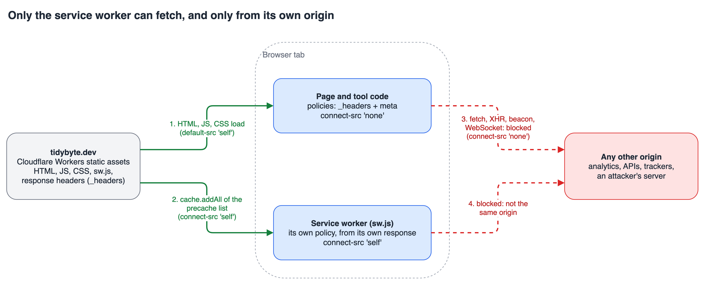

Developers paste things into online tools that they would never put in a public chat: a JWT from staging, a JSON payload with customer data, a connection string with the password still in it. Every "format your JSON online" site says it doesn't store what you paste. Almost none of them can prove it, and you can't tell the difference between a site that doesn't upload your input and a site that just says so.

I built [Tidybyte](https://tidybyte.dev), a small toolbox of developer utilities (JSON, Base64, regex, diff and more), and I wanted the claim "nothing you paste leaves your browser" to be something the browser itself enforces, and something my own test suite would catch me breaking. This article walks through how that works: the requirements, the options I weighed, the policy I ended up with, the one place it fights the platform (offline support), and what it still can't stop.

## Who this is for

You should be able to use this if you build a static or mostly client-side site that handles data people care about (a converter, a viewer, a local-first app) and you want a privacy promise that goes beyond a paragraph in a footer. You need a basic idea of what a Content Security Policy (CSP) is. I measured everything in Chromium, and I say where that matters.

## The need, and the requirements it creates

The need in one sentence: a visitor should be able to paste a secret into a tool and not have to trust me, because the page is technically unable to send it anywhere.

That breaks down into five requirements, and the rest of the article is judged against them:

1. **Enforced by the browser, not by good intentions.** A stated policy isn't enough. Something has to stop the request.
2. **It survives my own mistakes.** A future dependency, a copy-pasted analytics snippet or a debugging `fetch` must not be able to leak input silently.
3. **No `'unsafe-inline'`.** A policy that allows arbitrary inline script is mostly decoration.
4. **It works offline.** The site is an installable app, so a service worker has to download the site's own files.
5. **Anyone can check it.** The visitor with the Network tab open, and CI on every commit.

## Options I considered

| Option | 1. Enforced | 2. Survives mistakes | 5. Checkable |
|---|---|---|---|
| A privacy policy page only | No | No | No |
| "No backend" (static hosting) | Partly: nothing receives data, but the page can still call anyone | No | Partly |
| Self-discipline plus code review | No | Only while reviewers catch everything | No |
| **A strict CSP with tests that assert it** | **Yes** | **Yes, a violating change breaks the build** | **Yes, headers and Network tab** |

"No backend" deserves a note, because it is the most common answer. A static site has no server of mine to log your input, but the JavaScript running in your tab can still `fetch` anything on the internet. A static host proves nothing about that. The CSP closes it.

## The policy: what each directive is for

The core is two directives. `default-src 'self'` says everything the page loads (scripts, styles, fonts, frames, media) must come from its own origin. `connect-src 'none'` says the page may not open any connection at all: not to other sites, and not even back to its own origin.

`connect-src` is the directive that governs the channels code uses to send data: `fetch`, XHR, `WebSocket`, `EventSource`, `navigator.sendBeacon` and the `ping` attribute on links. So the page can load its own scripts, but those scripts cannot phone home.

I checked this instead of trusting the documentation. I loaded a built tool page in Chromium and tried each channel against a made-up host, intercepting at the network layer so that only requests the browser actually let out would show up:

| Attempt from page code | Result |
|---|---|
| `fetch` | blocked by CSP |
| `navigator.sendBeacon` | blocked by CSP |
| `WebSocket`, `EventSource` | blocked by CSP |
| ``, `<script src>`, `<iframe src>` | blocked by CSP |
| `<link rel="prefetch">` | blocked by CSP |
| `<a ping>` click | blocked by CSP |
| `location.href = ...` | **reached the network** |

The last row is the honest part, and I come back to it below.

## Two policies, because of how the framework hydrates

Tidybyte is built with Astro, which hydrates interactive components with two small inline bootstrap scripts. A strict policy normally forbids inline scripts, and I didn't want `'unsafe-inline'`. Astro's CSP support solves this by hashing its own inline scripts and listing the hashes. In `astro.config.mjs`:

```js
export default defineConfig({
  build: {
    // Never inline CSS/JS: keeps the CSP free of 'unsafe-inline'.
    inlineStylesheets: 'never',
  },
  security: {
    csp: {
      directives: [
        "default-src 'self'",
        "img-src 'self' data:",
        "font-src 'self'",
        "connect-src 'none'",
        "worker-src 'self'",
        "manifest-src 'self'",
        "object-src 'none'",
        "base-uri 'none'",
        "form-action 'none'",
      ],
    },
  },
});
```

The build emits that as a `<meta http-equiv="content-security-policy">` on every page, with `script-src` and `style-src` entries holding the SHA-256 of each inline script, never `'unsafe-inline'`. Setting `inlineStylesheets: 'never'` keeps CSS in external files so the style policy stays hash-free for it.

A `<meta>` policy cannot do everything, though. Directives like `frame-ancestors` are ignored in a meta tag, so I send a second policy as a real HTTP header from `public/_headers`, which the host applies:

```text
/*
  Content-Security-Policy: connect-src 'none'; object-src 'none'; frame-ancestors 'none'; base-uri 'none'; form-action 'none'
  X-Content-Type-Options: nosniff
  Referrer-Policy: no-referrer
  Permissions-Policy: camera=(), microphone=(), geolocation=(), interest-cohort=()
```

Two details here matter. First, when a page has several policies, the browser enforces all of them, so the effective policy is the intersection: a request must pass every one. That is why repeating `connect-src 'none'` in both places is safe. Second, the header deliberately has no `default-src` or `script-src`. If it did, it would block the hashed inline scripts, because the header knows nothing about those hashes.

`Referrer-Policy: no-referrer` and `form-action 'none'` close two smaller leaks: the URL doesn't travel to sites someone clicks through to, and a form can't post anywhere.

## The conflict: offline support versus `connect-src 'none'`

Requirement 4 said the app must work offline. That needs a service worker that downloads the site's own files into a cache when it installs. The worker's `cache.addAll()` is a fetch, and I had just forbidden fetching.

I tested what actually happens before designing around it. The finding was specific: a service worker's requests are governed by the CSP delivered with **the worker script's own response**, not by the page's policy. With the site-wide `connect-src 'none'` also applied to `sw.js`, an empty worker installs fine, but any precaching in `install` fails and the worker ends up `redundant`.

So `sw.js` gets its own policy, and only it. In `_headers`:

```text
/sw.js
  ! Content-Security-Policy
  Content-Security-Policy: connect-src 'self'; object-src 'none'; base-uri 'none'; form-action 'none'
  Cache-Control: no-cache
```

The `! Content-Security-Policy` line detaches the policy the `/*` block set. Without it, the host joins the two headers and `'none'` still wins, so precaching keeps failing. I confirmed the result on the live site: the response for `/sw.js` carries a single policy with `connect-src 'self'`.



The page keeps `connect-src 'none'`, so a `fetch()` from tool code is still blocked. The only code with a network permission is a worker that requests a list of same-origin files generated at build time. That list is built by a small Astro integration from the files in `dist/`, so it isn't something anyone edits by hand and the worker has no other fetch path.

A related pitfall: the precache must include the hashed JS and CSS under `/_astro/`, not just the HTML. A page cached without its scripts renders offline but never hydrates, which looks like a working app until you click anything.

## Making the promise break loudly

A policy in a config file is easy to weaken without noticing: a new feature needs one domain, someone adds it, and the guarantee is gone. So the guarantee lives in the test suite (Playwright), which runs against the built `dist/` served with the real `_headers`. Astro's own preview server ignores that file, so I use a small static server that applies it, including per-path blocks and the `!` detach line.

Three kinds of check:

```ts
test('security headers are present', async ({ request }) => {
  const res = await request.get('/');
  const csp = res.headers()['content-security-policy'];
  expect(csp).toContain("connect-src 'none'");
  expect(csp).toContain("frame-ancestors 'none'");
  expect(res.headers()['referrer-policy']).toBe('no-referrer');
});

test('page policy blocks all connections, even to the same origin', async ({ page }) => {
  await page.goto('/tools/json-format');
  const results = await page.evaluate(async () => {
    const out: string[] = [];
    for (const target of [location.origin + '/favicon.svg', 'https://example.com/']) {
      try { await fetch(target); out.push('allowed'); } catch { out.push('blocked'); }
    }
    return out;
  });
  expect(results).toEqual(['blocked', 'blocked']);
});
```

The third is generated per tool: every folder under `dist/tools` gets a test that loads the page, types a fake secret into the input, waits half a second for any delayed beacon, and asserts that no request left for another origin and no fetch, XHR, WebSocket or beacon fired. Add a tool and it is covered automatically. I also checked that weakening the policy makes these fail, which is the point of having them.

The service worker has its own test asserting the exact opposite on `sw.js` (`connect-src 'self'`, and exactly one `connect-src` in the response) while the page still says `'none'`.

## What a CSP does not stop

The probe table above has a row that isn't blocked: assigning `location.href` sent a document request to the made-up host. No CSP directive stops a navigation. `form-action` covers form submissions, and `frame-src` covers embedded frames, which is why the `<iframe>` row was blocked, but changing the page's own address isn't covered.

Calling that out matters, because it shapes what the guarantee is. It is strong against the realistic failure modes: a script I shipped by accident, a compromised dependency, an injected snippet, any attempt to exfiltrate quietly in the background. A navigation, by contrast, is visible: the tab leaves the site. It does not protect against someone who controls the code deliberately doing that, and it does nothing about things outside the page, like browser extensions, malware, or the clipboard. The privacy page lists those limits, and I think a privacy claim should.

Another honest limit: I measured this in Chromium. Other engines implement CSP, but I haven't run the same probe there, so treat the table as Chromium's behaviour.

## Trade-offs: what this policy costs

- **No analytics, no error reporting, no third-party anything.** `connect-src 'none'` isn't a setting you carve exceptions into without weakening the claim. Traffic comes from the host's server-side numbers instead, not from a script.
- **Ads conflict with it.** An ad network needs script, frame, image and connect permissions on the page, and its script could read what someone pasted. If I add ads later, the loose policy has to apply only to pages without tools. A per-path `_headers` rule makes that possible, and `/tools/*` keeps `connect-src 'none'`.
- **Debugging is harder.** A blocked request shows up as a console violation, and policies split across a meta tag and headers are easy to misread. The `securitypolicyviolation` event helped me more than reading policy strings.
- **Hosting must support custom headers.** GitHub Pages can't set them. Cloudflare's static assets do, and a `_headers` file in the build output is enough.

## What to take away

If a privacy claim matters to your users, don't leave it as prose. The decision rule I'd use: **list every channel your page can use to send data, close the narrowest directive that covers each one, then write a test that tries to use it.**

To apply it to your own project:

1. Start with `default-src 'self'` and `connect-src 'none'`, and see what breaks. Whatever breaks is the list of things you have been sending out.
2. If a framework needs inline scripts, use hashes (or a nonce on a server-rendered page) instead of `'unsafe-inline'`.
3. Put anything a meta tag can't express (`frame-ancestors`) in a response header, and remember both policies are enforced.
4. If you ship a service worker, give `sw.js` its own response policy, and check on the live host that the headers aren't merged.
5. Test against the built output with the real headers, and assert both sides: the page is blocked, and the intended exception works.
6. Write down what the policy does not cover, starting with navigation.

I started this wanting a sentence I could put on the page. What I got is one the browser enforces and CI re-checks on every commit, and a short list of the cases it doesn't cover. You can try the result and open the Network tab at [tidybyte.dev](https://tidybyte.dev).
