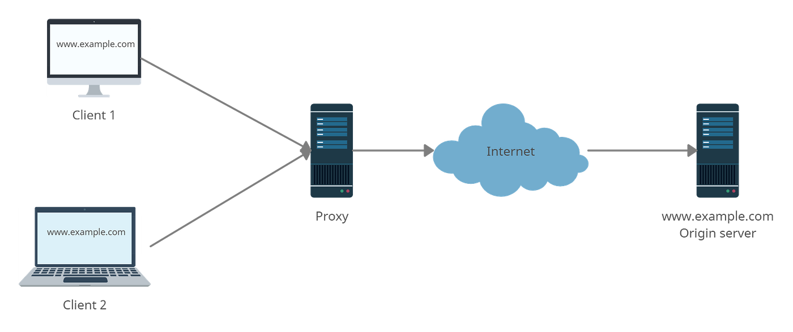
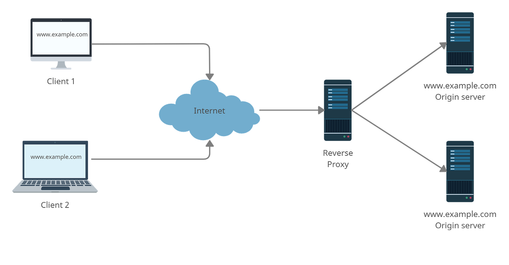

*Photo by [Pankaj Patel](https://unsplash.com/@pankajpatel?utm_source=medium&utm_medium=referral) on [Unsplash](https://unsplash.com?utm_source=medium&utm_medium=referral)*

A proxy is a device that traffic gets routed through it: it is an intermediate between a client and a web server.

There are many types of proxies, each one serves different services. In this article, we are going to explain the difference between a forward proxy and a reverse proxy.

## Forward proxy

*Proxy*

When people say proxy they typically mean a forward proxy.

In standard communication, when a user connects to a web server, the request goes from the client to the webserver directly. With a forward proxy in place, the traffic issued by the client is going to hit the proxy then the proxy will forward that traffic to the Internet. The proxy in this case will communicate with the webserver on behalf of the client.

The forward proxy sits in front of the client. To make it simple, the proxy processes the outgoing requests.

As an example, let’s say that you work in a big company and there are a lot of computers, those computers make a lot of requests to the same website to get some information. The company can set up a proxy so that all the employees make requests to this forward proxy that can do a bunch of things before it forwards the request to the server.

Let’s look at some of the things a proxy can do:

- **Content filtering**: the administrator wants to prevent certain traffic from coming in, or some websites that the company decided some of them are inappropriate or can not be used(censoring)
- **Caching**: a lot of the employees are getting the same information, again and again, the proxy can cache the request and return it, the request won’t have to go to the Internet, this saves the company’s money by reducing bandwidth usage and give a better user experience with faster response.
- **Logging**: This can give the company a way to get information about the network activity, how much data is downloaded, and the websites used frequently to better fine-tune the client infrastructure within the company.
- **Client anonymization**: if you request a server your network info is sent to the server so it can send the reply back to you, but that can carry a lot of information to the server, maybe your location. People use a proxy to do some sort of *anonymization* before the request goes out so that the server has less info about the client, and you can feel more secure in your identity or location.

## Reverse proxy

*Reverse proxy*

A reverse proxy is a server placed in front of one or more web servers and which intercepts requests from clients. It is different from a forward proxy, which is placed in front of the clients. With a reverse proxy, requests sent by clients to a website’s origin server are intercepted at the edge of the network by the reverse proxy server. It sends then the requests to the origin server.

The difference between a forward proxy and a reverse proxy is subtle but important. A simple way to sum it up would be to say that a forward proxy goes in front of a client and guarantees that there is no direct communication between an origin server and that specific client. A reverse proxy, on the other hand, sits in front of an origin server and ensures that there is no direct communication between a client and the protected origin server.

Let’s take a look at some of the things a reverse proxy can do:

- **Load balancer**: a popular website with millions of users every day may not be able to handle all of the incoming traffic using a single origin server. Instead, the website can be spread across a set of different servers, all of which are dedicated to processing requests for the same website. In this case, a reverse proxy can be a load balancing solution to distribute the incoming traffic evenly among the different servers to avoid overloading one of them. In the event of a complete failure of one server, the other servers can take over to handle the traffic.
- **SSL encryption**: encrypting and decrypting each client’s SSL (or TLS) communications can be expensive for an origin server in terms of computation. A reverse proxy can thus be configured to decrypt all incoming requests and encrypt all outgoing responses, in order to free up precious resources on the origin server.
- **Caching**: content caching improves the user experience. For example, a user in London visiting a website associated with a reverse proxy (and having web servers in Sydney) can connect to a local reverse proxy server in London, which will then take care of communicating with a server originated in Sydney. The proxy server will then cache (or temporarily save) the response data. Users in London who subsequently visit this site will get the locally cached version in response from the London reverse proxy server, resulting in a faster browsing experience. This will also reduce the load on the back-end server.
- **Authentication**: In some cases, with an application deployed on many servers, implementing the authentication in each server can be hard to manage. In this case, the authentication can be implemented in the reverse proxy and only the requests that get authenticated can get access to the back-end servers. On the server-side, when a request reaches beyond the reverse proxy, we know that the authentication was successful and the request can be handled correctly.

## Summary

In this article, we examined the different types of proxies and described the different cases in which each type of proxy can be used. Nowadays, it is so important to understand the flow of the requests in the network and the mechanisms put in place to make communication over the Internet reliable and cost-effective.
