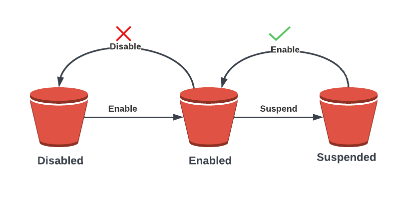
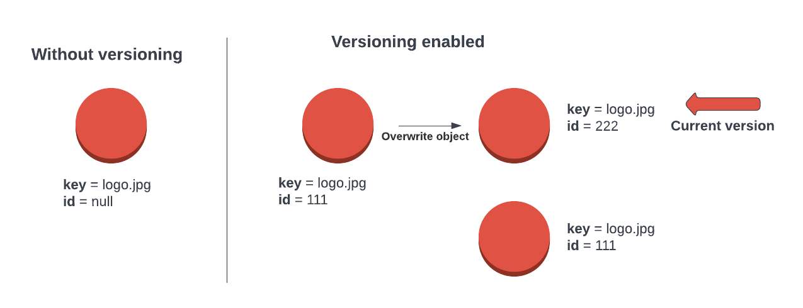

Object versioning is a powerful feature that allows you to store multiple versions of an object within a bucket. By default, versioning is disabled on a bucket, but you can easily enable it if desired. Once enabled, you cannot disable it, but you can suspend it if needed. A suspended bucket can be re-enabled at any time.

Without versioning enabled, each object in a bucket is identified solely by its unique name, or object key. If you modify an object, the original version is replaced. However, with versioning enabled, any modifications to an object generate a new version while leaving the original intact. For example, let’s say you have a bucket with a picture called “logo.jpg”. If you modify or delete this object, those changes will impact the original object.

Each object in a version-enabled bucket has a unique ID that is allocated by S3. When versioning is disabled, the ID of objects in that bucket is set to null. This means that any modifications to an object will replace the original version.

On the other hand, if you upload a new object to a version-enabled bucket, S3 allocates a new ID to that object. Any modifications made to this object will generate a new version while retaining the old one. The newest version of any object in a version-enabled bucket is known as the current version of the object.

When accessing an object in S3, if you do not explicitly indicate which version you require, the current version will always be returned. However, you do have the ability to request a specific version by providing its ID. This means that versions can be individually accessed by specifying the ID, and if no ID is specified, it is assumed that you want to interact with the current version of the object.

Versioning also affects deletions. For example, if you have two different versions of “logo.jpg” stored in a version-enabled bucket and you indicate to S3 that you want to delete the object without specifying a version ID, S3 will add a new special version of that object known as a delete marker. This delete marker is just a new version of the object that makes it appear as though it has been deleted, but in reality, it is just hidden. The delete marker is a special version of an object that hides all previous versions of that object. However, you can delete the delete marker, which essentially undeletes the object, returning the current object to an active state, and all previous versions of the object still exist and are accessible using their unique version ID.

Even with versioning enabled, you can fully delete a version of an object by specifying the particular version ID that you want to remove. If you are deleting the most recent version of an object, the next most recent version becomes the current version. This means that you have complete control over the versions of your objects in S3, allowing you to manage them in a way that suits your needs.

It is important to understand that enabling versioning in a bucket means that all versions of an object will remain in that bucket, resulting in the consumption of space for each version. For instance, if you have a single object that is 1 gigabyte in size and you have ten versions of that object, then you are consuming ten times the space for that one object and its multiple versions. Additionally, you will be billed for all versions of all objects within an S3 bucket.

To optimize your storage usage and minimize costs, it is recommended to regularly review and delete unnecessary versions of objects. This can be done manually or through the use of lifecycle policies. By implementing these best practices, you can effectively manage your S3 storage and ensure efficient use of resources.
