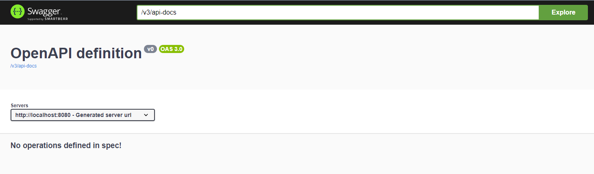
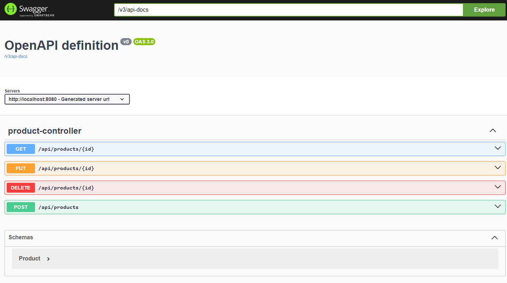
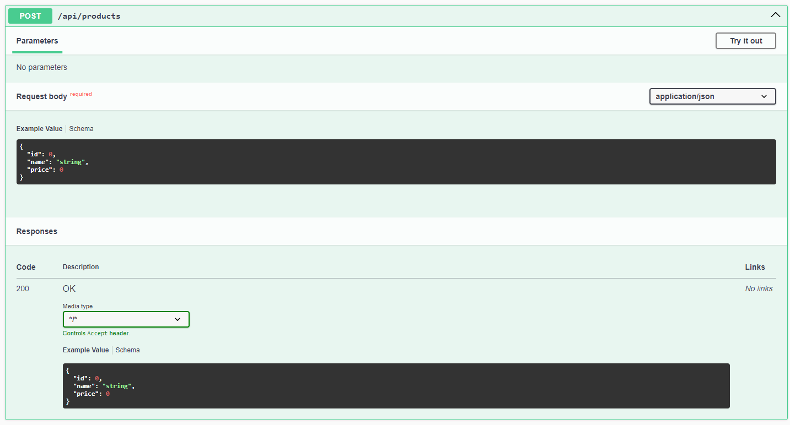
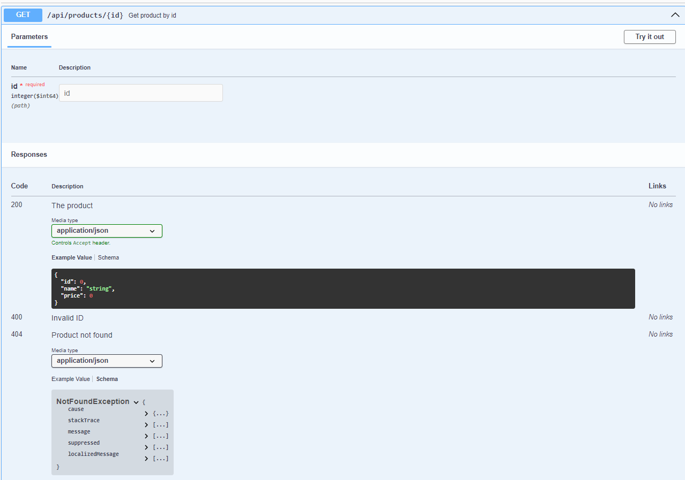

Documenting REST APIs is important so that consumers of these APIs can know exactly how to integrate them into their systems. This documentation can be written manually, which will be time-consuming and error-prone, or generated automatically using libraries. Here comes to play the [springdoc-openapi](http://springdoc.org/) library.

In this blog post, we will see how to use this library and integrate it into our spring boot project to have up-to-date documentation of our REST APIs.

## Library description

`springdoc-openapi` is a Java library that automates the generation of API documentation using Spring boot projects.

It operates by analyzing an application during runtime to deduce API semantics from Spring configurations, class organization, and diverse annotations.

We should note that it is a community-based project, meaning that it's not maintained by the contributors of the Spring Framework.

## Example Code

This article is accompanied by a working code example [on GitHub](https://github.com/bakic/blog-code-examples/tree/main/openapi-documentation).

## Setting up springdoc-openapi for Spring Boot 3

Spring Boot `3.x` requires the use of  [version 2.x](https://github.com/springdoc/springdoc-openapi/releases/tag/v2.5.0) of [springdoc-openapi](https://central.sonatype.com/search?q=springdoc-openapi-starter-webmvc-ui).

For Maven:

```xml
<dependency>
    <groupId>org.springdoc</groupId>
    <artifactId>springdoc-openapi-starter-webmvc-ui</artifactId>
    <version>2.5.0</version>
</dependency>
```

For Gradle:

```
implementation group: 'org.springdoc', name: 'springdoc-openapi-starter-webmvc-ui', version: '2.5.0'
```

### What About Spring Boot 2

According to the community who built this library,`springdoc-openapi v1.8.0 `is the latest Open Source release supporting Spring Boot `2.x` and `1.x`.

So in order to use the latest features of the library, an upgrade to Spring Boot 3 is required.

## Getting the OpenApi Documentation

After setting up the dependencies, we can start the spring boot application.

Once the application is started on the default port 8080, we can use this URL to get the OpenApi definitions:

```
http://localhost:8080/v3/api-docs
```

The result is the following:

```json
{
  "openapi": "3.0.1",
  "info": {
    "title": "OpenAPI definition",
    "version": "v0"
  },
  "servers": [
    {
      "url": "http://localhost:8080",
      "description": "Generated server url"
    }
  ],
  "paths": {},
  "components": {}
}
```

By default, we get a `json` representation of the OpenApi definitions.

If we want a `yaml` representation, we can get it by accessing the following URL:

```
http://localhost:8080/api-docs.yaml
```

The result will be the following:

```yaml
openapi: 3.0.1
info:
  title: OpenAPI definition
  version: v0
servers:
- url: http://localhost:8080
  description: Generated server url
paths: {}
components: {}
```


## Swagger-ui Integration with Spring Boot

The library that we added in the previous section is also responsible for deploying the `swagger-ui` to our spring boot application.

There is no additional configuration needed to have `swagger-ui`

Having the spring boot application running, we can use the following URL to get to swagger-ui interface:

```
http://localhost:8080/swagger-ui/index.html
```



For the moment, we have nothing special in the result that we got: we are only seeing default values generated.

What we will do next is that we will add some REST endpoint and check the result again.

## Implementing Rest APIs

Let's have a simple example of a Rest APIs implementations using Spring boot.

FIrst, let's defined a model class to represent  basic entity, for example `Product`

```java
public class Product {
    private Long id;
    private String name;
    private double price;
}
```

Next, let's create a controller class to handle HTTP requests related to the `Product` entity:

```java
@RestController
@RequestMapping("/api/products")
public class ProductController {
    
    private final ProductService productService;

    @GetMapping("/{id}")
    public Product getProductById(@PathVariable Long id) {
        // Retrieve product from database or any other data source
        return productService.getProduct(id)
                .orElseThrow(() -> new NotFoundException("Product not found"));
    }

    @PostMapping
    public Product createProduct(@RequestBody Product product) {
        // Save product to database or any other data source
        return product;
    }

    @PutMapping("/{id}")
    public Product updateProduct(@PathVariable Long id, @RequestBody Product updatedProduct) {
        // Update product in database or any other data source
        return updatedProduct;
    }

    @DeleteMapping("/{id}")
    public void deleteProduct(@PathVariable Long id) {
        // Delete product from database or any other data source
    }
}
```

In this example, we created four endpoints to manage products:

- Get a product: `GET /api/products/{id}`
- Create a product: `POST /api/products`
- Update a product: `PUT /api/products/{id}`
- Delete a product: `DELETE /api/products/{id}`

If we run our application again and view the documentation at:

```
http://localhost:8080/swagger-ui-custom.html
```



If we select one of the endpoints, the create product for example, we can see more details like the request body and the response code.



Still, this documentation is missing a lot of information that can help the users who will consume these endpoints to understand what each action does, the media type, the meaning of each field, the meaning of error codes if there are any, and much more.

## Add Documentation Using Swagger Annotations

Swagger provides annotations that can add more information to your documentation. A complete list of these annotations can be found in [this link](https://github.com/swagger-api/swagger-core/wiki/Swagger-2.X---Annotations).

```java
@GetMapping("/{id}")
    @Operation(summary = "Get product by id",
            responses = {
                    @ApiResponse(responseCode = "200", description = "The product",
                            content = @Content(mediaType = "application/json",
                                    schema = @Schema(implementation = Product.class))),
                    @ApiResponse(responseCode = "404", description = "Product not found",
                            content = @Content(mediaType = "application/json",
                                    schema = @Schema(implementation = NotFoundException.class))),
                    @ApiResponse(responseCode = "400", description = "Invalid ID",
                            content = @Content)}
    )
    public Product getProductById(@PathVariable Long id) {

        return productService.getProduct(id)
                .orElseThrow(() -> new NotFoundException("Product not found"));
    }
```

We added documentation to only the get product endpoint.

The output in swagger is the following:



Now we have more information describing our API like 

- the response code and the description of the payload returned
- The exceptions and the meaning of each one

There are more annotations that we can use to describe our endpoints in a better way like `@RequestBody`, `@Parameter` and so on.

## Summary

Documenting Rest APIs is important to give a useful information to consumers of these APIs.

With the `springdoc-openapi`library, it's easy now to automate documentation generation. This will lead us to have up-to-date documentation.
