When it comes to mobile applications, SMS messaging is still one of the most reliable and widely used communication channels. Amazon Web Services (AWS) provides a service called Simple Notification Service (SNS) that allows you to send SMS messages to mobile devices. In this article, we will walk you through the step-by-step process of setting up AWS SNS SMS in your Java project. We will cover creating an AWS account, configuring SNS to send SMS messages, creating an IAM user, and sending SMS messages from your Java application. By the end of this guide, you will have a solid understanding of how to implement AWS SNS SMS in your Java project.

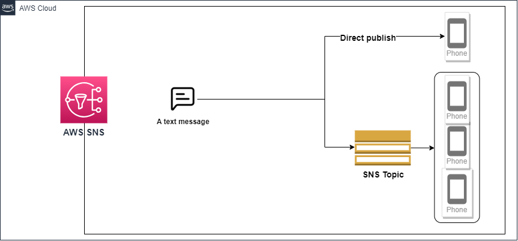

#### What is AWS SNS SMS


AWS SNS SMS is a service that allows you to send SMS messages to mobile devices through the AWS SNS service. SNS is an event-driven messaging platform that can be used to send messages to a variety of endpoints, including SMS-enabled phones. With SNS, you can publish messages to a topic, and subscribers who have requested to receive messages on this topic will receive the message.

#### Benefits of using SNS for SMS

Using SNS for SMS messaging provides businesses with a cost-effective and scalable solution to reach their customers quickly. It allows businesses to send messages to multiple recipients simultaneously, without the need for any additional infrastructure. SNS also provides end-to-end encryption, ensuring that messages are secure during transmission.

#### Cost of SMS messages sent using AWS SNS

AWS charges per SMS message sent, and the cost varies depending on the country you are sending the message to. However, the cost is relatively low compared to other SMS gateways.

#### Sending SMS messages

Sending an sms message using AWS SNS can be achieved in two ways:

- By publishing to an SNS topic: To efficiently send a single SMS message to multiple phone numbers, you can subscribe those numbers to an Amazon SNS topic. This topic serves as a communication channel where you can add subscribers and broadcast messages to all of them simultaneously. Once subscribed, a recipient will receive all messages published to the topic until they opt-out or you cancel their subscription.

  This feature is particularly useful for businesses or organizations that need to send out mass notifications or updates. By utilizing Amazon SNS, you can streamline your messaging process and ensure that your audience receives your message promptly.

- By publishing to a mobile phone: Amazon SNS allows you to send SMS messages directly to a mobile phone, without the need to subscribe the phone number to an Amazon SNS topic. 

## Setting up AWS SNS for SMS in Your Java Project

#### Creating an AWS Account


To get started with AWS SNS, you need to create an AWS account. Simply go to the AWS home page, sign up for an account, and provide the required information. Once you have created your account, you can log in to the AWS Management Console.

#### Creating a Java Project


Create a new Java project in your development environment of choice, such as Eclipse or IntelliJ. Make sure the project is configured to use Java 11 or higher.

#### Setting up the AWS SDK for Java


You need to install the AWS SDK for Java to interact with SNS. You can do this by adding the AWS SDK for Java as a dependency in your project. To do this, add the following dependency to your project's pom.xml file:
```xml
<dependency>
    <groupId>com.amazonaws</groupId>
    <artifactId>aws-java-sdk-sns</artifactId>
    <version>1.12.459</version>
</dependency>
```
## Creating an IAM User for SNS Access

#### What is IAM and why it is important

AWS Identity and Access Management (IAM) is a service that empowers you to securely manage access to your AWS resources. With IAM, you can easily create and manage users, as well as their permissions, to ensure that your AWS resources remain protected at all times. IAM provides a comprehensive suite of tools and features that enable you to control access to your resources with ease, including multi-factor authentication, role-based access control, and more.

#### Creating an IAM User with SNS Access

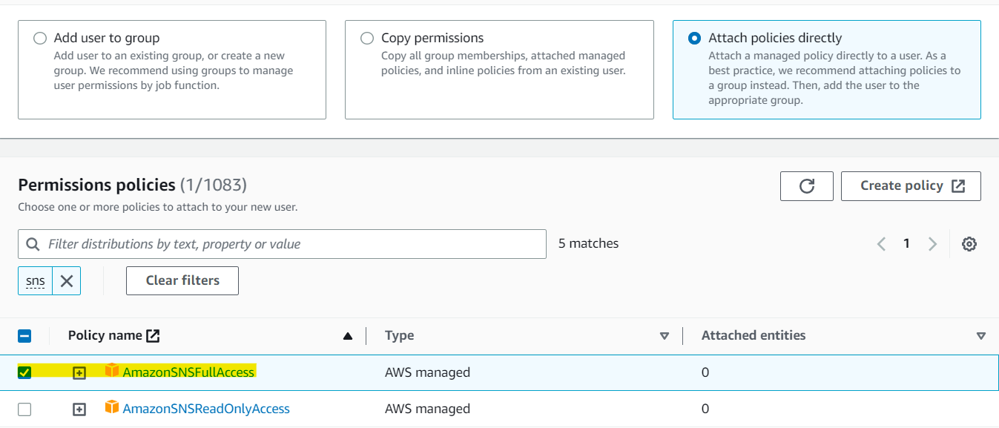


To create an IAM user with SNS access, log in to the AWS Management Console and navigate to the IAM console. Click on "Users" and then "Add users." Provide a name for the user, and select "Programmatic access" as the access type. Next, select "Attach existing policies directly" and search for "AmazonSNSFullAccess." Check the box next to the policy, and click "Next." Review the user's information and click "Create user."

#### Setting Up Access Keys for Your IAM User

After you have created your IAM user, you need to generate access keys to access AWS resources programmatically. To do this, navigate to your IAM user within the AWS Management Console, and click on the "Security credentials" tab. Click on "Create access key", choose "Local code" to enable the pplication code in a local development environment to access our AWS account, and then click on "Create access key" button.

Download the CSV file containing the access keys or copy/paste them in a secure location since the access keys are generated only once. If uou lose them, you will have to create new access keys.

## Configuring SNS to Send SMS Messages

In the following we are going to send SMS messages using an SNS topic to which phone numbers were subscribed.

As previously stated, it is possible to send SMS messages either by publishing to a topic that multiple phone numbers are subscribed to or by sending a message directly to a phone number.

#### Creating an SNS Topic

To create an SNS topic, navigate to the Amazon SNS console and click "Create topic." Provide a name for the topic, and select "Standard" as the type. Once the topic is created, note down its ARN (Amazon Resource Name).

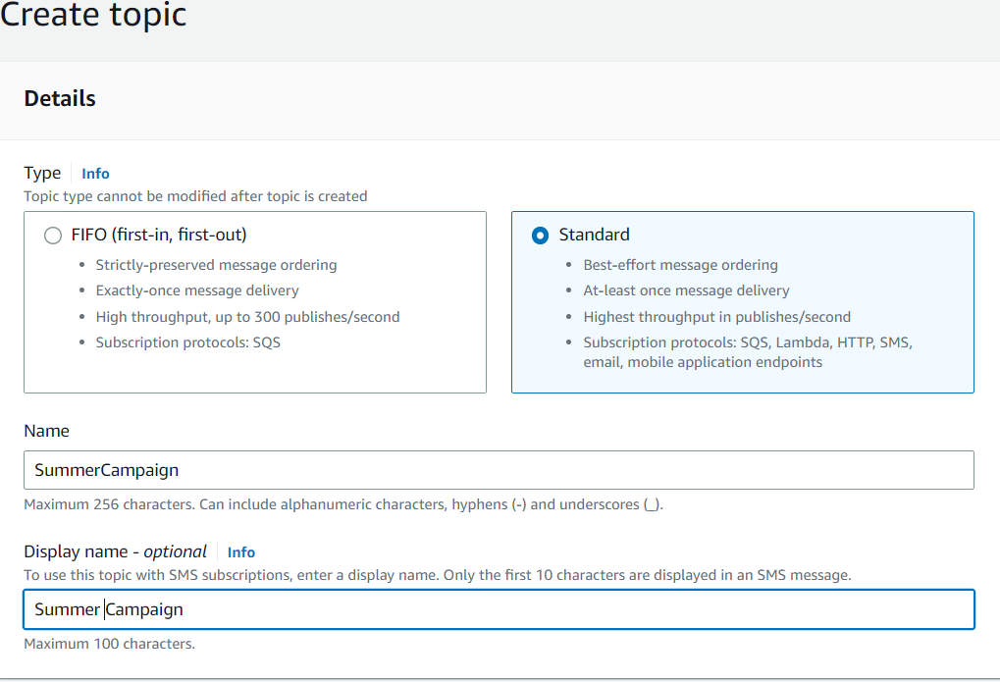

We should note the topic ARN since we are going to need it later when we will send messages to the topic. The topic ARN has the followingformat: `arn:aws:sns:aws-region:accountId:topicName`

#### Verifying Phone Numbers for SMS

When you open the Text Messaging (SMS) section , you notice the following message:

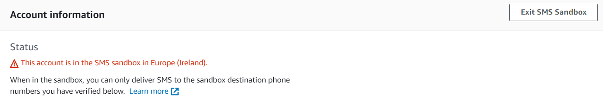

This means that for the moment your account is not a production one regarding SMS delivery and you can send messages only to some phone numbers that you should verify first. To do this, navigate to the "Text messaging (SMS)" section within the SNS console and click "Add Phone Number." 

Enter the phone number and click "Verify." An SMS message with a verification code will be sent to the phone number. The subscriber must enter the code within 15 minutes to complete the verification process.

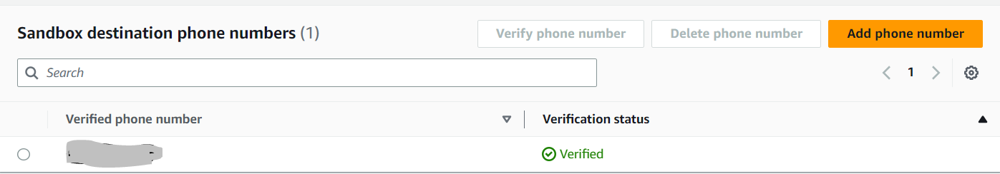

#### Adding SNS Subscribers for SMS

To add subscribers to your SNS topic, click on the "Subscriptions" tab within the SNS console. Click "Create subscription" and select "SMS" as the protocol. Enter the phone number of the subscriber (including the country code), and click "Create subscription."

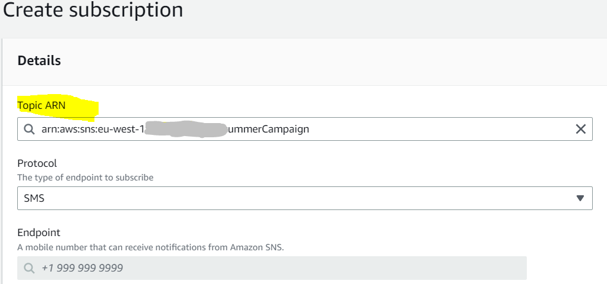

The subscription is then displayed in the "Subscriptions "list of the Topic

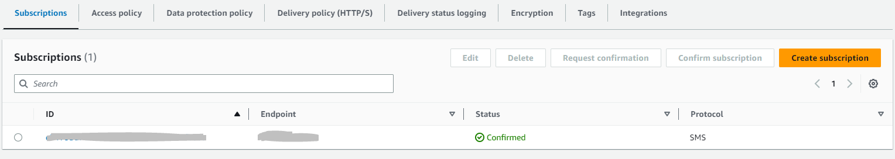

That's it! You have now set up AWS SNS SMS and you can start sending text messages to your customers.

## Sending SMS Messages from Your Java Application

If you've followed the steps in the previous sections, you're now ready to send SMS messages from your Java application! Here's how:

### By publishing to an SNS topic

#### 	Creating an SNS Client in Java

​	Before you can send an SMS message, you need to create an SNS client in Java:

```java
AwsBasicCredentials basicCredentials = AwsBasicCredentials.create(accessKey, secretKey);
StaticCredentialsProvider staticCredentialsProvider = StaticCredentialsProvider.create(basicCredentials);

SnsClient snsClient = SnsClient.builder()
                    .region(Region.EU_WEST_1)
                    .credentialsProvider(staticCredentialsProvider)
                    .build();
```

​	Make sure to replace `accessKey` and `secretKey` with your own AWS access key ID and secret access key. Of course you can change the region to use the region where you set up your SNS configuration.

#### 	Creating an SMS Message and Publishing it via SNS

​	Once you have an SNS client, you can create an SMS message and publish it via SNS:

```java
String message = "My First SMS message from AWS";
String topicArn = "YOUR_TOPIC_ARN"
PublishRequest publishRequest = PublishRequest.builder()
                    .message(message)
                    .targetArn(topicArn)
                    .build();
PublishResponse publishResponse = snsClient.publish(publishRequest)
```

​	Make sure to replace `message` with your own message and `topicArn` with the topic ARN we created in the first step.

#### 	Handling SNS SMS Responses in Java

​	When you publish an SMS message via SNS, you'll receive a response from AWS indicating whether the message was successfully delivered or not. Here's how to handle the response in Java:

```java
String messageId = publishResponse.getMessageId();
if (messageId != null) {
System.out.println("SMS message sent with message ID: " + messageId);
} else {
System.out.println("SMS message failed to send");
}
```

If the message was successfully delivered, you'll see the message ID in the console. If it failed to send, you'll see an error message.

### By publishing to a mobile phone

To send a message directly to a mobile phone, we only need an SNSClient, a message and the phone number to which the message will be sent:

```java
AwsBasicCredentials basicCredentials = AwsBasicCredentials.create(accessKey, secretKey);
StaticCredentialsProvider staticCredentialsProvider = StaticCredentialsProvider.create(basicCredentials);

SnsClient snsClient = SnsClient.builder()
                    .region(Region.EU_WEST_1)
                    .credentialsProvider(staticCredentialsProvider)
                    .build();

String message = "My First SMS message from AWS";
String phoneNumber = "+123456789"
PublishRequest publishRequest = PublishRequest.builder()
                    .message(message)
                    .phoneNumber(phoneNumber)
                    .build();
PublishResponse publishResponse = snsClient.publish(publishRequest);
```

## Monitoring and Troubleshooting SNS SMS

It's important to monitor the performance of your SNS SMS setup and troubleshoot any issues that arise. Here are some tips for doing so:

#### Viewing SMS Delivery Statistics

You can utilize the Amazon SNS console to access comprehensive statistics regarding your recent SMS deliveries.

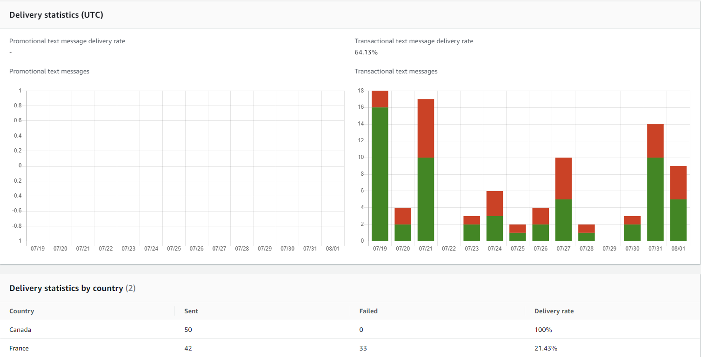

To get theses statistics, while you are on the aws console:

1. On the navigation panel, choose **Text messaging (SMS)**.
2. navigate to the **Text messaging (SMS)** page to access the charts displaying the delivery status of your transactional and promotional SMS messages. Each chart shows the following data for the preceding 15 days:
   - Delivery rate (percentage of successful deliveries)
   - Sent (number of delivery attempts)
   - Failed (number of delivery failures)

#### Viewing Cloudwatch Logs

To gather data on both successful and unsuccessful SMS message deliveries, you can enable Amazon SNS to record information in Amazon CloudWatch Logs. Whenever you send an SMS message, Amazon SNS generates a log entry containing details such as the message price, the status indicating success or failure, the reason behind any failures, the time the message spent in the system, and additional relevant information. This feature allows you to gain valuable insights into the delivery process and analyze the performance of your SMS messages.

We should note that by default, this feature is disabled !!!

To enable and view CloudWatch Logs for your SMS messages:

1. On the **Mobile text messaging (SMS)** page, in the **Delivery status logs** section, choose **Edit preferences** .
   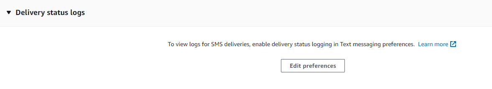

2. On the next page, expand the **Delivery status logging** section.
   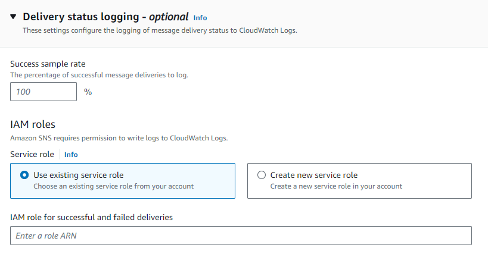

3. For **Success sample rate**, specify the percentage of successful SMS deliveries for which Amazon SNS will write logs in CloudWatch Logs. For example:

   - To write logs only for failed deliveries, set this value to 0.
   - To write logs for 10% of your successful deliveries, set it to 10.

   If you don't specify a percentage, Amazon SNS writes logs for all successful deliveries.

#### Viewing Amazon Cloudwatch Metrics

Amazon SNS automatically gathers metrics on the delivery of your SMS messages and sends them to Amazon CloudWatch. With CloudWatch, you have the ability to monitor these metrics and set up alarms that notify you when a metric exceeds a certain threshold. This allows you to stay informed about your SMS delivery rate and keep track of your SMS charges for the current month.

In the following section, we will explore the metrics that display the charges for SMS usage in the current month. To access this information, please follow the steps outlined below:

1. Begin by navigating to the AWS console and selecting the CloudWatch service
2. Locate the side panel and click on \"Metrics\" followed by \"All metrics.\"
3. Ensure that you have chosen the appropriate AWS region.
4. In the search bar, enter the term \"sns.
5. A variety of metric groups will be displayed. Please select \"SNS > Metrics with no dimensions.\"
6. You will now find a specific metric labeled as \"SMSMonthToDateSpentUSD.\" This metric provides a breakdown of the amount spent on sending SMS messages for each month.

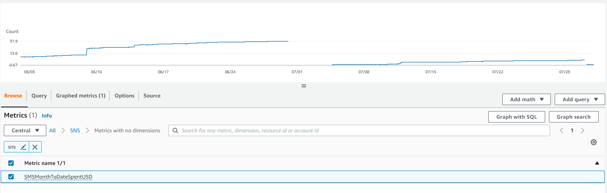

This metric can be utilized to establish an alarm that will promptly notify the administrator via email when the expenditure surpasses a predetermined limit before the month concludes.

## 8. Conclusion

In this article, we've walked through a step-by-step guide for setting up AWS SNS SMS in your Java project. We started by setting up the necessary AWS resources, including an SNS topic and subscription, and configuring the topic to send SMS messages. Then, we created an SNS client in Java, created an SMS message, and published it via SNS. Finally, we covered how to monitor and troubleshoot SNS SMS, as well as best practices for using SNS SMS in your Java application.

## External Resources

https://docs.aws.amazon.com/sns/latest/dg/sns-mobile-phone-number-as-subscriber.html
